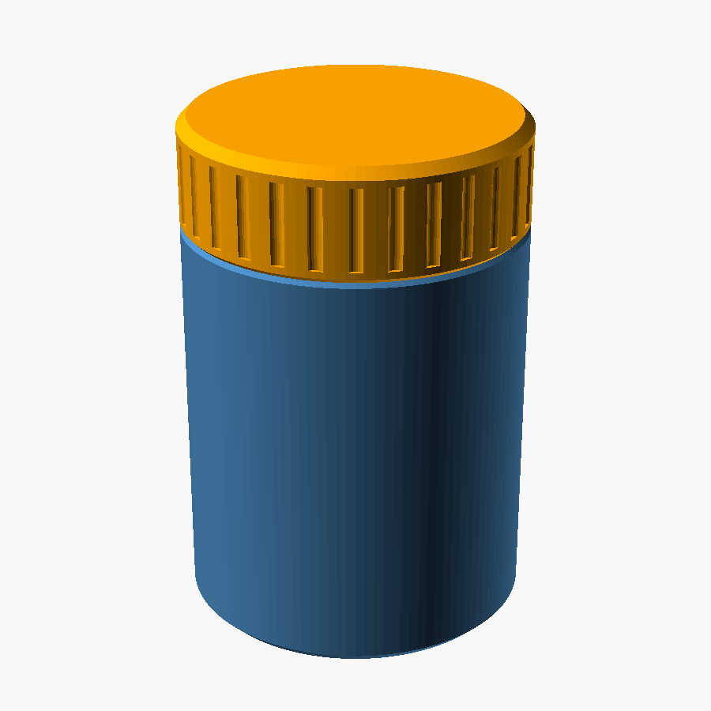
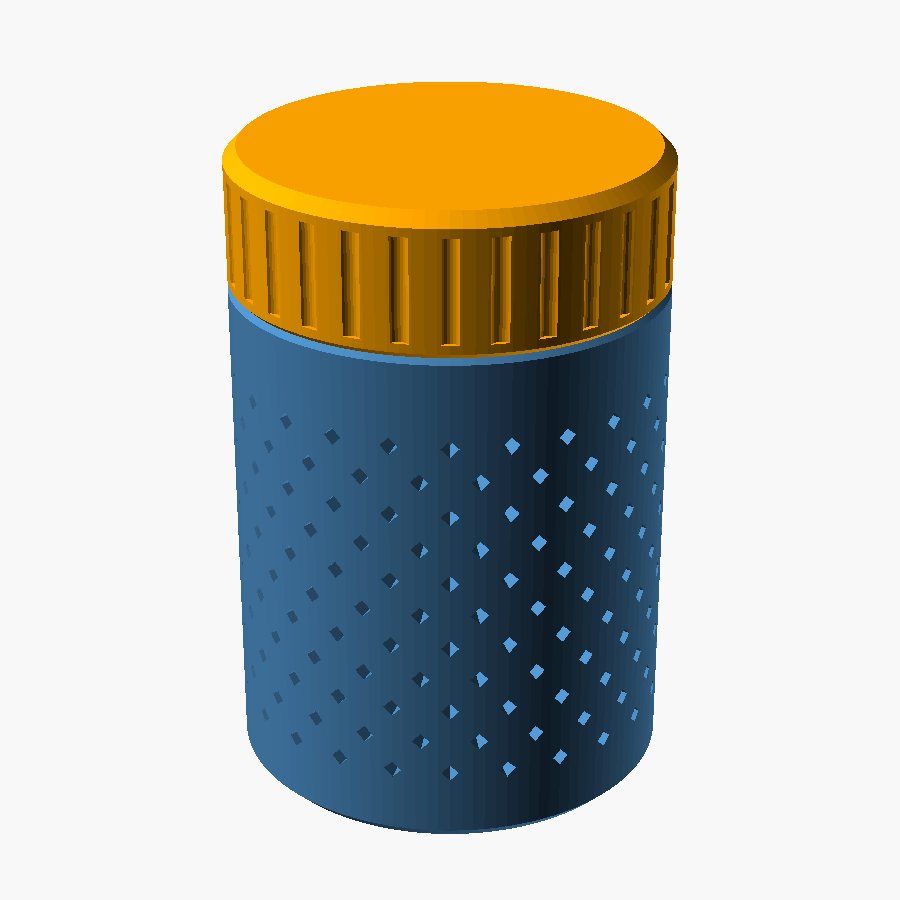
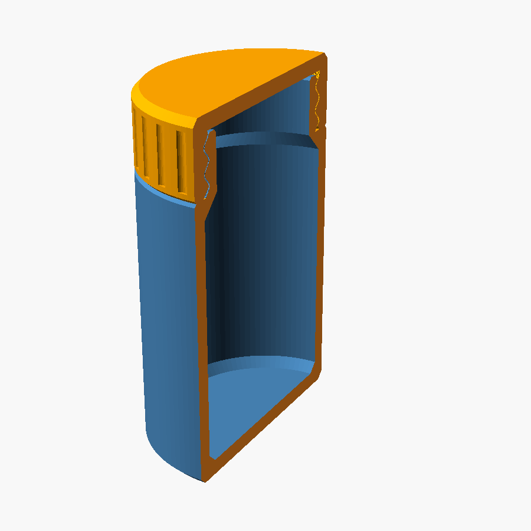
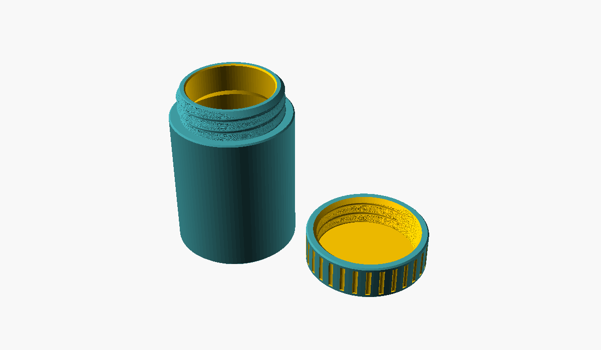

# Filament Spool Weight or Desiccant Jar

A sturdy, 3D-printable screw-top jar that sits in the center hole of a filament spool.

- **As a spool weight:** fill it with steel BBs. When a spool gets close to empty, it's light enough to ride up in the AMS as filament is pulled through. The weighted jar keeps it seated.
- **As a desiccant jar:** turn on the perforated option and fill it with desiccant beads.

The model is a single parameterized OpenSCAD file, [`spool_weight_jar.scad`](spool_weight_jar.scad), and needs no libraries. Every dimension can be set in the OpenSCAD Customizer.

## Features

- 50 mm outside diameter × 75 mm tall by default, with the lid flush to the body so the whole jar fits a spool's center hole. Both dimensions are adjustable.
- Thick walls (3.2 mm sides, floor and lid top) for drop resistance.
- A coarse (5 mm pitch), rounded, single-start thread. It has no sharp roots for cracks to start from, and neither part needs supports.
- The lid's skirt seats on the jar's shoulder, so a drop's force goes through the full wall rather than through the thread.
- Chamfered outer edges, a 45° fillet inside the floor, and a 45° interior shoulder that prints without supports.
- Grip grooves on the lid.
- An optional perforated body: staggered diamond-shaped holes that print cleanly in a vertical wall.
- When rendered, it reports the mouth diameter, interior volume, and how many BBs it holds and what they weigh.

| Perforated (desiccant) | Cutaway |
|---|---|
|  |  |

## User's Guide

### Rendering

1. Open `spool_weight_jar.scad` in OpenSCAD and open the Customizer.
2. Choose a `part`:
   - `print`: the jar and lid side by side in print orientation (lid upside down). This is the normal choice for export.
   - `jar` or `lid`: one part by itself, in print orientation.
   - `assembled` or `cutaway`: views for checking the design. Don't print these.
3. Render (F6) and export STL or 3MF.

With the defaults, the console reports a 35.1 mm mouth and about 94 cm³ of interior volume. Full of 4.5 mm steel BBs, that's about 1,220 BBs, or 427 g. You don't have to fill it; add BBs until the spool behaves.

### Key parameters

| Group | Parameter | Default | Notes |
|---|---|---|---|
| Overall size | `outer_d` | 50 | Must fit your spools' center hole |
| | `height` | 75 | Assembled height |
| Walls | `wall`, `floor_t`, `lid_top_t`, `lid_wall` | 3.2 | Thicker is tougher but holds less |
| | `neck_wall` | 2.4 | Measured inside the thread root |
| Thread | `thread_pitch` | 5 | |
| | `thread_depth` | 1.5 | Peak to root |
| | `thread_length` | 12 | Neck length / lid skirt depth |
| | `thread_clearance` | 0.35 | Radial clearance. Raise it if the lid is tight, lower it if it's sloppy |
| Perforations | `perforated` | false | Turn on for desiccant |
| | `hole_size` | 2.0 | Diamond width. Must be smaller than your beads (and your BBs) |
| | `holes_around`, `hole_row_pitch` | 24, 4 | Hole density |
| Fill estimate | `bb_d`, `bb_g`, `packing` | 4.5, 0.35, 0.62 | Only affect the capacity report |

Every numeric parameter has a range and step annotation, so the Customizer keeps decimal values.

### Printing

- **Material:** PETG (or PETG-CF). PLA is too brittle to trust in a drop with several hundred grams of steel inside.
- **Make the walls solid.** This matters as much as the wall thickness does. Set wall loops high enough to fill the 3.2 mm walls (about 8 with a 0.42 mm line) and use 8 or more top and bottom shell layers, or simply use 100% infill.
- **Layer adhesion:** a dropped jar usually splits between layers. Print PETG on the warm end of its range with modest part cooling.
- **Layer height:** 0.16–0.2 mm works well for the thread.
- **Orientation:** the jar upright, the lid upside down (top on the plate). No supports needed.

### Use

Pour in BBs (or desiccant), screw the lid down until it seats on the shoulder, and set the jar in the spool's center hole.

If you use the perforated version for desiccant, keep it out of BB duty: the holes weaken the wall.

### Drop testing

A jar printed from this design survived a 2 ft drop onto a concrete floor. The design is intended to survive about 4 ft, but that has not been tested.

## Credits

Designed and written by Claude (Anthropic) at the direction of Bob Drzyzgula.

## License

MIT. See [LICENSE](LICENSE).
